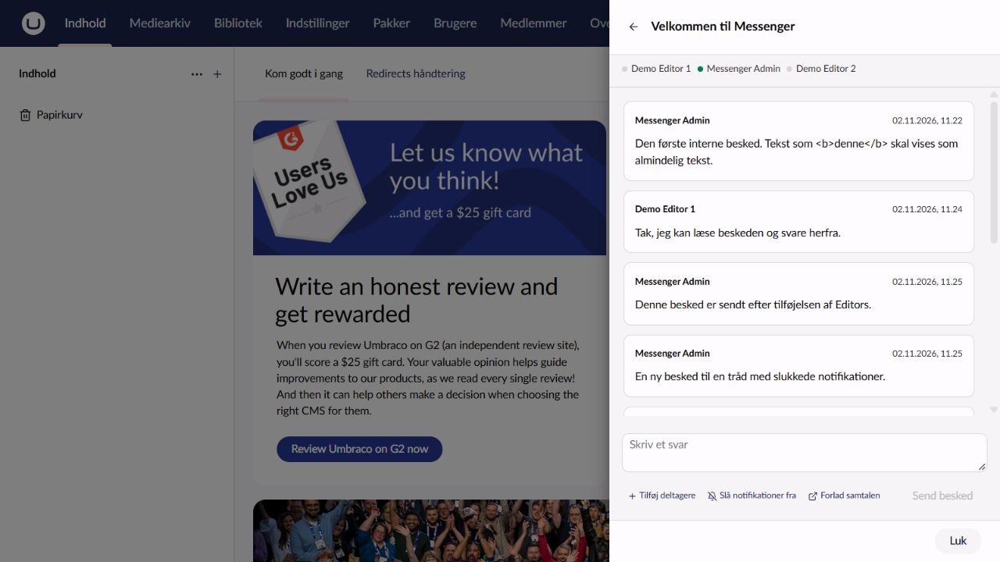

# Messenger for Umbraco

Internal, plain text conversations for Umbraco backoffice users. The header button opens the standard Umbraco sidebar, like the user profile. Includes English, Danish, German, Dutch, French, Italian, Spanish, Swedish and Norwegian Bokmål UI, unread indicators, mute, participant invitations, presence and typing indicators.

## Screenshots

Messenger uses Umbraco's native sidebar, with the conversation subject and back button in the header and reply controls at the bottom.



See the [illustrated guide](docs/using-messenger.md#screenshots) for the conversation list, group recipients and participant history options. Screenshots show the Danish UI in the Umbraco 18 demo; the same Messenger layout is used on Umbraco 17.

## Installation

Use the package major matching your Umbraco major. Package consumers do not need Node.

```sh
dotnet add package Umbraco.Community.Messenger --version 18.0.0
```

`main` builds 18.x for Umbraco 18 (`[18.0.0,19.0.0)`); `v17/main` builds 17.x for Umbraco 17 (`[17.0.0,18.0.0)`). Both target .NET 10. Restart the site to run package migrations, then sign in to the backoffice.

See [using Messenger](docs/using-messenger.md), [local development and demo](docs/development.md) and the [API contract](docs/api-contract.md).

## Operational limits

This first release supports a single application server. Durable messages and visibility are stored in the Umbraco database; presence and typing are process-local. Multi-server deployment needs coordinated live-event delivery and distributed presence, as well as appropriate SignalR hosting/backplane configuration. A backplane alone does not distribute this package's presence state. Proxies must support SignalR transports and the authenticated `/umbraco/messengerHub` endpoint.

Messages are plain text. No email, attachments, editing or deletion. Subjects allow 120 characters and messages 100,000; a conversation allows 100 expanded participants including its creator. The recipient directory returns enabled account and group names, with up to 50 users and 50 groups per query; search is limited to 100 characters. Group search examines the first 1000 groups. Search for recipients outside the initial results.

Source code is available on [GitHub](https://github.com/skttl/umbraco-messenger). MIT licensed; see [third-party notices](THIRD_PARTY_NOTICES.md).
