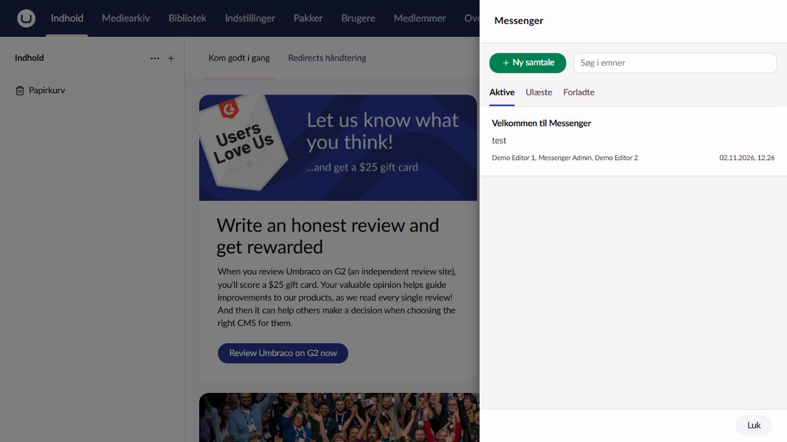
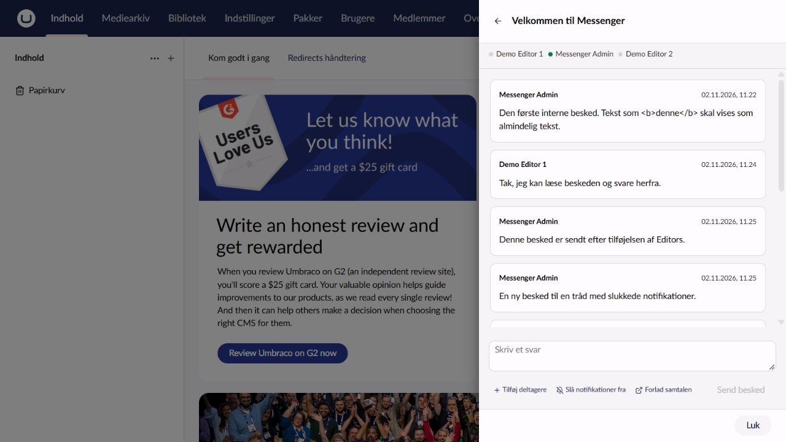
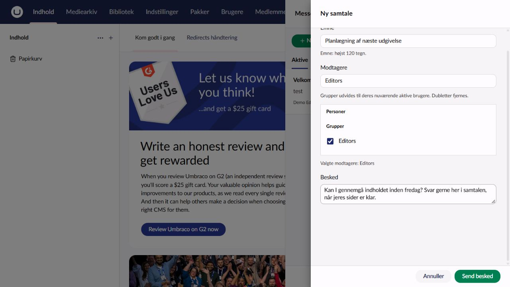
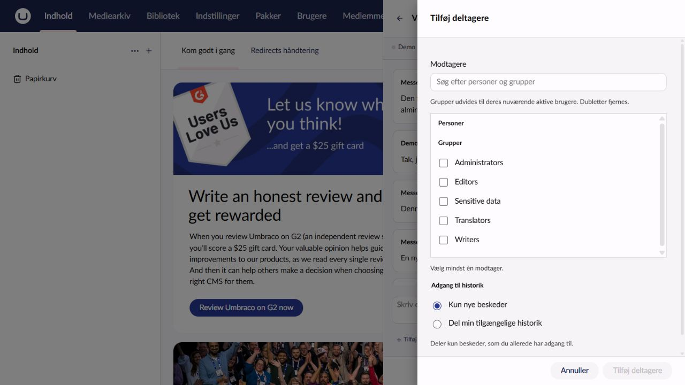

# Using Messenger

Select the speech bubbles in the backoffice header to open Messenger. Messenger uses the same full-height sidebar and dimmed backdrop as the user profile. Escape or Close closes it. Umbraco manages focus and closes the sidebar on navigation. Reply drafts remain in the Messenger context.

Choose New conversation, enter a subject and message, then select users or groups. A group is expanded to its current enabled users once when sending or inviting: later group membership changes do not alter the conversation.

The header counts unread, unmuted conversations. Muted conversations keep their unread state in the conversation list. Messages become read when displayed in an open conversation; leaving the list open does not read incoming messages. Open a conversation to reply or manage its participants.

Any active participant can invite more users or groups. The default shares only new messages. Sharing history grants only the history the inviter can already read; it cannot expose somebody else's inaccessible messages.

Leaving stops future messages and live updates, and prevents replying or inviting. Already accessible history remains readable. If somebody invites you again, new messages are accessible; messages sent while you were absent stay hidden unless an authorized inviter explicitly shares that history.

Online and typing indicators are temporary and visible only to active participants in a shared conversation. Multiple tabs count as one online user. Reconnecting reloads stored conversations and unread state.

Search and New conversation share one toolbar row. In a conversation the header contains the back arrow and subject; participant, mute and leave actions sit beside the reply composer. New conversation and Add participants open a second native sidebar; Cancel or Escape returns to the underlying panel. Leave uses a confirmation dialog. Pending submissions cannot be cancelled; failed submissions preserve their fields.

Messages allow up to 100,000 characters, without a visible character counter. Existing installations already store message bodies in an unlimited text column, so this change needs no migration. Bodies use HTTP endpoints; SignalR only announces changes by conversation ID.

## Screenshots

These screenshots show the Danish UI in the Umbraco 18 demo. The same Messenger layout is used on Umbraco 17. User names and messages belong to the local demo.

### Conversation list

Open Messenger from the header. Search by subject or use the Active, Unread and Former filters. New conversation sits beside the search field.

### Reading and replying

The header shows the subject and back arrow. Participants and online presence appear beneath it. Reply at the bottom, where you can also add participants, mute notifications or leave the conversation.

### New conversation

New conversation opens a second sidebar. Enter a subject, choose users or groups and write the first message. The example shows an unsent draft addressed to Editors; groups expand to their current enabled users when sent.

### Adding participants

Add participants opens a second sidebar above the conversation. New participants receive only new messages by default. Choose Share my accessible history to grant access to messages you can already read.

